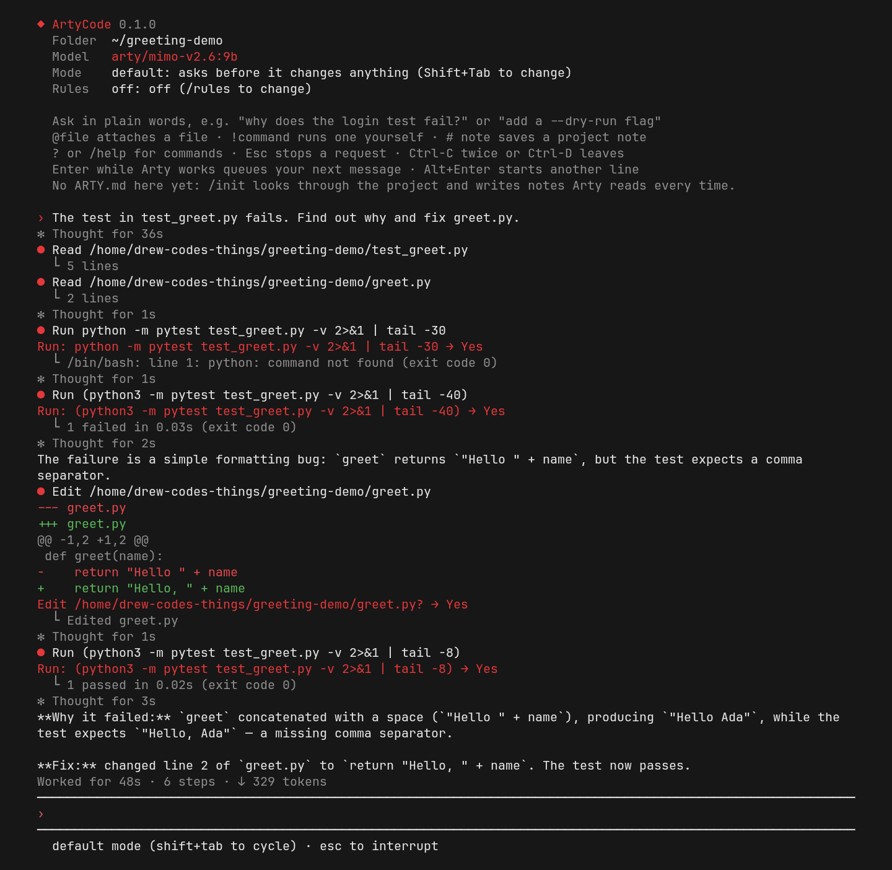

<div align="center">

# ArtyCode

**A coding assistant in your terminal: it reads, edits and runs code in the folder you start it in, and asks before it changes anything. It runs on your own Arty.**

[](https://github.com/drew-codes-things/ArtyCode/actions/workflows/tests.yml)


[](LICENSE)

[Project home](https://github.com/drew-codes-things/ArtyCode) · [Arty, the assistant it belongs to](https://github.com/drew-codes-things/Arty)

</div>



---

## Overview

ArtyCode (the `arty` command, also `arty-cli`) is a coding assistant for the terminal on Debian (and other Linux) and Windows. You ask in plain words
("why does the login test fail?", "add a --dry-run flag"), and it looks through the project, makes the change and
runs the tests. The file tools and the shell always run on your computer. The thinking happens on your own
[Arty](https://github.com/drew-codes-things/Arty) brain (its own coding model unless you pick another: the first `arty/` model it marks for coding, or
`arty/qwen3:14b` when it marks none or can't be asked quickly; this is never saved as your choice), so your
code only ever goes to your own server. You need an Arty API key, or to approve this computer in Arty from your browser.

It reads, edits and runs code with a set of [tools](docs/tools.md), and asks before it changes or runs anything
(see [Safety and permissions](#safety-and-permissions)).

## Requirements

- Python 3.11 or newer.
- Debian (or another Linux) or Windows; what has been run on each is under [Limits](#limits).
- An [Arty](https://github.com/drew-codes-things/Arty) brain you can reach, and either an Arty API key or the right
  to approve this computer in Arty from your browser.

## Install

Python 3.11 or newer. The installers (and pipx) also fetch prompt_toolkit and Pygments, the two libraries ArtyCode needs, from PyPI.

**Debian (and other Linux), one line:**

```bash
curl -fsSL https://raw.githubusercontent.com/drew-codes-things/ArtyCode/main/install.sh | bash
```

Run that way the installer downloads the project's newest code itself. It never asks for sudo. Or, from an ArtyCode
folder you already have,

```bash
./install.sh
```

It makes its own environment in `~/.local/share/arty-cli` (marked as its own with a `.arty-cli-install` file) and adds
`arty` and `arty-cli` to `~/.local/bin`. If something else is already called `arty` there, it is left alone and you
use `arty-cli`. `./install.sh --uninstall` removes it again and keeps your settings; it refuses to touch a folder it
didn't make. `ARTY_CLI_SOURCE` installs from another folder, a `.tar.gz`/`.zip` URL or a git URL (https only).

**Windows:** in PowerShell, from an ArtyCode folder,

```powershell
powershell -ExecutionPolicy Bypass -File .\install.ps1
```

It finds Python (the `py` launcher first), makes its own environment in `%LOCALAPPDATA%\arty-cli` and adds `arty` and
`arty-cli` to your PATH. Open a new terminal afterwards. `.\install.ps1 -Uninstall` removes it and keeps your
settings in `%APPDATA%\arty-cli`. The same `ARTY_CLI_SOURCE` works.

Then type `arty`. The first run asks how to log in.

With [pipx](https://pipx.pypa.io) instead: `pipx install .`

### Checking the setup and updating

`arty doctor` prints a short checklist, one line each with a tick or a cross: the settings file, the brain, this
computer's key, the models, web search, the sandbox tool, a browser for screenshots, git and the terminal. It never
prints the key or any other secret. `arty update` updates a clean git checkout in place, or prints the one command
to run for any other install; `arty update --check` only reports whether a newer version is out. Neither ever uses
sudo. More in [Checking the setup and updating](docs/checking-and-updating.md).

## Logging in

Login never asks for the brain's address: it comes from the saved settings or the environment, `ARTY_URL` for the
address on your network (`http://<AI_ADDRESS>:8081/v1`) and `ARTY_REMOTE_URL` for the address from anywhere
(`https://<your address>/v1`, with `ARTY_ACCESS_CLIENT_ID` and `ARTY_ACCESS_CLIENT_SECRET` if Cloudflare Access guards
it). When neither is known, `arty login` (and the first run) shows the lines to copy for your shell (`export` on Linux,
`$env:` and `setx` in PowerShell) and saves nothing.

`arty login` (or `arty-cli login`) then offers exactly two ways in:

1. **API key.** Paste an Arty API key.
2. **Browser login.** ArtyCode shows a short code and opens Arty in your browser. Approve it there and ArtyCode
   receives a key of its own for this computer. From outside your home network this needs the Cloudflare Access id
   and secret first. Plain `http://` is only accepted for an address on your own network; a public address has to
   use https.

Everything is saved to `~/.config/arty-cli/config.json` (`%APPDATA%\arty-cli\config.json` on Windows), readable only
by you. For Arty the home address is tried first, then the other. Before the key is sent to a plain `http://` home
address, the brain there has to prove it knows the key (it answers a random challenge at `/v1/identity` without the
key being sent; a per-device key is proved through its SHA-256), so on another network whatever happens to sit at that
address never sees it.

Environment variables, the optional limits and what the error messages mean are in
[Configuration](docs/configuration.md).

## First run

```bash
cd my-project
arty
```

Ask in plain words, for example `fix the add function in calc.py`. Each step shows as a `●` line with its result under
it, and anything that changes a file or runs a command asks first:

```
● Edit calc.py
    1  def add(a, b):
    2 -    return a - b
    2 +    return a + b
Edit calc.py? → Yes
  └ Edited calc.py +1 -1
```

Answer **y** (yes), **a** (yes, and don't ask again for this until you quit) or **n** (no, then say what Arty should
do instead). When the job is done it sums up what it changed and how it checked it. A whole example chat is in
[The terminal interface](docs/terminal-interface.md).

Other ways to start it:

```bash
cd my-project
arty                                         # chat (arty-cli works too)
arty -p "what does main.py do?"              # ask once and exit
arty -p "list the TODOs" --output-format json  # ask once, one JSON object back
arty -p "fix the build" --output-format stream-json  # one JSON line per step as it works
arty --continue                              # carry on with the last conversation here
arty --resume <id>                           # an earlier one (/resume picks one in the chat)
arty --remote                                # chat, shared with your phone and starfire.ai (see docs/remote.md)
```

## Most-used commands and keys

| In the chat | What it does |
|---|---|
| `@path` | Attach a file with numbered lines, as if Arty had read it (so it can edit it at once); pictures go to the model's vision |
| `!command` | Run a command yourself; the model sees the output |
| `/undo` | Put back the last file change Arty made (again for the one before); a file Arty created is removed. Refused if the file changed again since |
| `/model` | A numbered list of every model downloaded on your Arty brain. The current one is marked with ● |
| `/init` | Look through the project and write `ARTY.md` (notes read every session) |
| `?` or `/help` | The commands and keys, in short groups (your own commands last) |
| `/resume` | Pick an earlier conversation and carry on with it |
| **Esc** | Stop the running request, keeping every step that finished |
| **Shift+Tab** | Move on to the next mode: default, auto-edit, plan, then default again |
| **Ctrl-O** or `/last` | Everything the last step with output gave back |
| **Ctrl-D** (on an empty line) or `/exit` | Leave |

Every command is in [Use](docs/usage.md#in-the-chat), and every key in
[The terminal interface](docs/terminal-interface.md).

## Safety and permissions

- The file tools and the shell run on your computer; your code only goes to your own Arty brain.
- In the default mode every edit and command asks first, showing the diff or the command. Look-only commands such as
  `ls`, `cat`, `grep` and `git status` that stay inside the project run without a question.
- `--permission-mode` (or `/mode`) sets how much is asked: `default`, `auto-edit` (edits inside the project without
  asking, apart from `.arty` and `.git` folders), `plan` (look and plan only) and `allow-all` (only for a folder you
  can throw away).
- Saved rules in `settings.json` or a trusted project's `.arty/settings.json` allow or forbid tools and commands. Deny
  wins over everything.
- A folder's own `ARTY.md`, `AGENTS.md` and `.arty` files are left out until you say you trust that folder.
- `--sandbox` also runs every command in a sandbox (bubblewrap on Linux, an AppContainer on Windows) where secrets in
  your home folder are hidden and there is no network unless you allow it.

Details: [Permissions](docs/permissions.md) and
[Checks after edits, project map and sandbox](docs/checks-and-sandbox.md).

## Documentation

The details live in [`docs/`](docs):

| Guide | What is in it |
|---|---|
| [Tools](docs/tools.md) | Every tool the model can use and whether it asks first; pictures, pages and live checks |
| [Permissions](docs/permissions.md) | Answering questions, permission modes, look-only commands, saved permission rules |
| [Use](docs/usage.md) | Starting it, JSON output for scripts, every chat command, `ARTY.md`, trusted folders, saved chats |
| [The terminal interface](docs/terminal-interface.md) | A full example chat, what each part of the screen does, every key, colours |
| [Long jobs](docs/long-jobs.md) | Jobs of many steps, the finish and tests checks, long conversations, a busy brain |
| [Checks after edits, project map and sandbox](docs/checks-and-sandbox.md) | Linting after edits, the project map, `--sandbox` |
| [Built-in working rules](docs/working-rules.md) | The engineering rules Arty works by and the `.arty/history.md` record |
| [Remote control](docs/remote.md) | Following and steering a chat from the Arty apps and starfire.ai |
| [Skills](docs/skills.md), [Helpers](docs/helpers.md), [Hooks](docs/hooks.md), [MCP servers](docs/mcp-servers.md) | Your own instructions, helpers, commands on events and extra tools |
| [Configuration](docs/configuration.md) | Environment variables, limits and what error messages tell you |
| [Checking the setup and updating](docs/checking-and-updating.md) | `arty doctor` and `arty update` in full |
| [Arty, ArtyCode and starfire.ai](docs/arty-and-starfire.md) | How the three projects work together and how to link them |

## Limits

- On Arty, the brain runs one model on the GPU at a time, so the first coding request after chatting with Arty (and
  the first chat after coding) waits while the other model loads.
- Where it has been run: Debian, the full test suite and daily use. Windows 10 22H2 in a virtual machine (Windows
  PowerShell 5.1, Python 3.12): the full test suite, `install.ps1` (a fresh install and an install over an older
  one), `arty --version`, `arty doctor`, and against a real Arty brain one-off jobs (`arty -p`) that read a file,
  edited one in auto-edit mode and ran its tests, ran PowerShell commands, ran a command in the AppContainer
  `--sandbox` (it could write in the project, and could not read or write in the user folder) and searched the web,
  plus a chat in the full-screen interface over SSH (questions answered with a letter, refused with Esc). Not run
  yet: Windows 11, Windows on ARM, a physical Windows PC, PowerShell 7 as the shell, and Windows Terminal or the
  classic console window opened directly on the machine.
- `web_fetch` checks that an address is public before connecting; a name whose address changes in between could
  still reach a local one.
- `screenshot` talks to the browser through its debugging port on 127.0.0.1 for the few seconds a shot takes, and a
  page opened from a file can show other files on this computer the way any local page can.
- A request sent from afar while you are typing at the prompt here clears the line you were typing.
- Not yet: editor (IDE) integration.

## Tests

```bash
python -m venv .venv && .venv/bin/pip install -e . pytest
.venv/bin/python -m pytest -q tests
```

The tests run against small local stand-in servers; no API key or network is used.

## License

[Apache License 2.0](https://www.apache.org/licenses/LICENSE-2.0) - see [LICENSE](LICENSE) and [NOTICE](NOTICE). You
can use, change and share ArtyCode, including commercially; if you share it or anything built from it, keep the LICENSE
and NOTICE files, which credit ArtyCode's author, and say what you changed.
